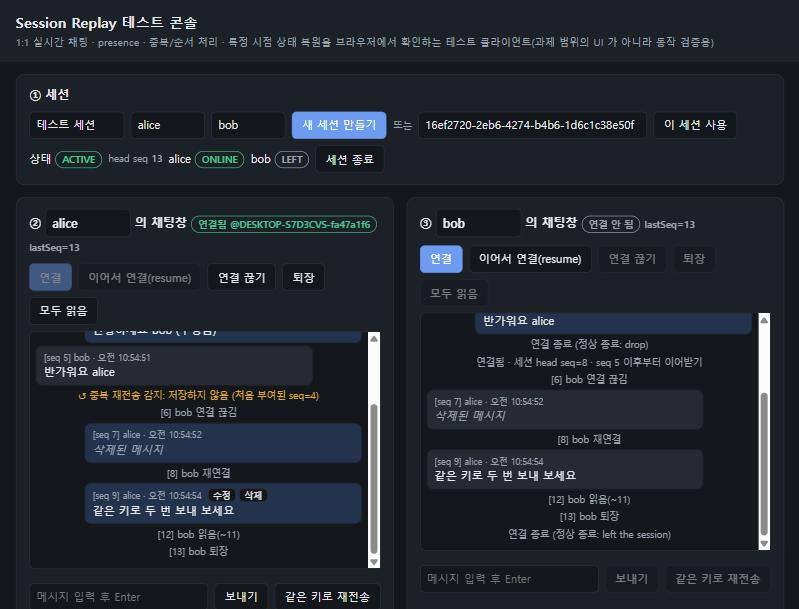

# Realtime Session Replay

[](https://github.com/khj0317/Creative/actions/workflows/ci.yml)

**1:1 실시간 채팅 + 이벤트 소싱 기반 특정 시점 상태 복원** 백엔드.

모든 상태 변화(참여/퇴장/연결 끊김/재연결/메시지/수정/삭제/읽음/종료)를 세션별로 **빈틈없이 단조 증가하는 `seq`** 를 가진 이벤트로 저장한다. 그 이벤트만으로 **어느 시점의 대화 상태든 결정적으로 복원**한다. 실시간 통신은 WebSocket 을 쓰고, 서버 2대 이상으로 수평 확장(Redis Pub/Sub)할 수 있다.

- 스택: Java 21 · Spring Boot 4.1 · PostgreSQL 17 · Redis 7 · Flyway · Micrometer/Prometheus/Grafana · Testcontainers · k6
- 문서: [설계](docs/design.md) · [DB/쿼리](docs/database.md) · [상태 복원](docs/event-sourcing.md) · [WebSocket 프로토콜](docs/websocket-protocol.md) · [부하 테스트](docs/load-test.md) · [OpenAPI](docs/openapi.yaml)

---

## 빠른 시작

**필요**: Java 21, Docker. Node 22 이상은 재현 스크립트용이며 의존성은 없다.

```bash
# 1) PostgreSQL(5440) + Redis(6390)
docker compose up -d postgres redis

# 2) 서버 실행 (http://localhost:8080, Swagger UI: /swagger-ui.html)
./gradlew bootRun            # Windows: dev.cmd

# 3) 시나리오 재현: 실시간 송수신 · 중복 재전송 · 순서 뒤바뀜 · 끊김/재연결 resume · 시점 복원 · AUTO==FULL 검증
node scripts/demo.mjs
```

### 수평 확장(서버 2대) + 장애 주입 + 관측성

```bash
./gradlew bootJar
docker compose --profile cluster up -d --build        # app-1(8081), app-2(8082), Nginx LB(8088), Redis Pub/Sub

node scripts/demo.mjs --a http://localhost:8081 --b http://localhost:8082   # alice 는 app-1, bob 은 app-2
node scripts/demo.mjs --base http://localhost:8088                          # LB 경유
node scripts/chaos-instance-down.mjs     # app-2 강제 종료 → 21초 뒤 bob DISCONNECTED(INSTANCE_DOWN) → 재연결 시 ACTIVE

docker compose --profile observability up -d   # Prometheus(9090) + Grafana(http://localhost:3300, 대시보드 자동 등록)
```

### 테스트

```bash
./gradlew test     # 단위 + 통합(Testcontainers PostgreSQL, 실제 HTTP/WebSocket). Docker 필요
```

| 테스트 | 검증 내용 |
|---|---|
| `SessionStateReducerTest` | 리듀서 결정성: 중복/역순 입력 무시, seq 빈틈은 실패, **모든 지점의 스냅샷+리플레이 == 전체 리플레이**, 무작위 대화 50개 |
| `EventIngestIntegrationTest` | 멱등 재전송, **같은 메시지 40개를 3번씩 동시 전송(120건) → 40개만 저장, seq 빈틈 없음**, 수정이 원본보다 먼저 오는 경우, 배치 항목별 결과, 1:1 정원과 초대, 종료 멱등, 목록 필터와 커서 |
| `TimelineAndProjectionIntegrationTest` | 시점 복원(수정 전/후, 퇴장, unread), 모든 seq 에서 AUTO==FULL, 비동기 프로젝션, **장애 주입 → 재시도 → DLQ → redrive**, 재구축 결과 동일 |
| `WebSocketIntegrationTest` | 실시간 전달과 ack/중복, typing, **끊김 → INTERRUPTED → lastSeq resume(빈틈·중복 없이)**, 연결 인계, **퇴장 시 해당 사용자의 모든 연결 종료**, **장애 인스턴스 reaper**, 초대받지 않은 사용자 거부 |

GitHub Actions 가 push 마다 같은 테스트를 실행한다(상단 배지).

### 브라우저 테스트 콘솔 (터미널 없이)

서버를 켠 뒤 **http://localhost:8080** 을 열면 동작 검증용 테스트 화면이 나온다. 과제 범위의 UI 가 아니라, 필수 기능 7개를 버튼으로 확인하기 위한 WebSocket 테스트 클라이언트다.

1. 「새 세션 만들기」를 누른 뒤 alice 와 bob 창에서 각각 「연결」을 누른다 → **join**, **실시간 송수신**(메시지 옆에 서버가 부여한 seq 표시)
2. bob 창에서 「연결 끊기」를 누르면 상단 상태가 `INTERRUPTED`, bob 이 `DISCONNECTED` 가 된다. 「이어서 연결(resume)」을 누르면 놓친 메시지를 순서대로 받고 `ACTIVE` 로 돌아온다 → **presence**
3. 「같은 키로 재전송」을 누르거나 ④ 에서 같은 키로 POST /events 를 두 번 보내면 `DUPLICATE` + 같은 seq 가 나오고 로그에는 1건만 남는다 → **수집 API**, **중복 방지**
4. 「원본보다 먼저 도착한 '수정' 보내기」를 누르면 `TARGET_NOT_FOUND`(재시도 가능)로 거절된다 → **순서 기준**
5. ⑤ 의 슬라이더를 움직이면 그 seq 시점의 참여자, presence, 메시지(수정·삭제 반영), 안 읽은 수가 복원된다 → **시점 복원**
6. 「퇴장」을 누르면 LEAVE 가 기록되고 연결이 닫힌다 → **leave**



### 수동 검증 (Postman / WebSocket 클라이언트)
- **Postman**: Import → File → `docs/openapi.yaml` 을 가져오면 모든 REST API 가 컬렉션으로 만들어진다. `X-User-Id` 헤더에 사용자 이름을 넣고 호출한다.
- **WebSocket**: Postman 의 WebSocket 요청이나 `wscat` 으로 `ws://localhost:8080/ws/sessions/{id}?userId=alice` 에 연결하고 `{"type":"send","clientEventId":"m1","payload":{"content":"hi"}}` 를 보낸다. 재전송, resume, 백오프까지 들어간 대화형 클라이언트는 `node scripts/chat-cli.mjs` 다.

---

## 환경 구성

| 구성 요소 | 버전 | 로컬 포트 | 비고 |
|---|---|---|---|
| Java | 21 | — | Gradle 9 wrapper 포함 |
| PostgreSQL | 17 | 5440 | `docker compose up -d postgres`, 스키마는 기동 시 Flyway 가 생성 |
| Redis | 7 | 6390 | `BROADCAST_MODE=redis` 일 때만 사용 |
| 애플리케이션 | Spring Boot 4.1 | 8080 (클러스터: 8081, 8082, LB 8088) | |
| Prometheus / Grafana | 2.55 / 11.3 | 9090 / 3300 | `--profile observability` |
| Node | 22+ | — | 재현/CLI 스크립트(의존성 없음) |

환경 변수(괄호는 기본값):

| 변수 | 설명 |
|---|---|
| `PORT` (8080) | HTTP/WebSocket 포트 |
| `DB_URL` (`jdbc:postgresql://localhost:5440/chat`), `DB_USERNAME` / `DB_PASSWORD` (chat/chat) | PostgreSQL 접속 |
| `DB_POOL_SIZE` (30) | Hikari 풀 크기. 인스턴스 수 × 풀 크기 < `max_connections` |
| `BROADCAST_MODE` (`local`) | `local` = 단일 인스턴스, `redis` = Redis Pub/Sub 로 인스턴스 간 전달(수평 확장) |
| `REDIS_HOST` / `REDIS_PORT` (localhost/6390), `REDIS_HEALTH` (false) | Redis 접속, 헬스체크 포함 여부 |
| `INSTANCE_ID` (hostname + 랜덤) | 하트비트/reaper/워커 lease 의 인스턴스 식별자 |
| `SNAPSHOT_INTERVAL` (100) | 자동 스냅샷 주기(seq 가 이 값의 배수일 때) |

그 밖의 튜닝 값(워커 주기, 재시도 횟수와 백오프, 인스턴스 타임아웃 등)은 [`application.yml`](src/main/resources/application.yml) 의 `chat.*` 에 있다.

### 기술 스택 선택 근거 (요약)
- **Java 21 + Spring Boot**: WebSocket, JDBC, Actuator, Micrometer 를 한 생태계에서 성숙하게 쓸 수 있다.
- **PostgreSQL**: 트랜잭션과 행 잠금으로 **세션 단위 seq 직렬화**를 단순하게 구현하고, `FOR UPDATE SKIP LOCKED` 로 DB 만으로 작업 큐(outbox)를 만든다. JSONB, 부분/표현식 인덱스도 쓴다.
- **JdbcClient(SQL 직접 작성)**: append-only 로그와 범위 조회, CTE 를 그대로 통제하고 실행 계획으로 설명하기 위해서다.
- **순수 WebSocket**: seq/ack/resume 을 직접 제어해야 해서 STOMP 브로커 의미론을 쓰지 않았다.
- **Redis Pub/Sub**: 가볍고 지연이 낮다. 내구성은 DB 가 보장하므로 Kafka/Streams 는 과하다.

자세한 비교와 버린 대안은 [design.md §1](docs/design.md#기술-선택-근거)에 있다. **가정**(인증 대체, 1:1 정원, 상태 정의, 시각 정밀도 등)은 [design.md §9](docs/design.md#9-가정-assumptions)에 모아 두었다.

---

## 과제 요구사항 대응표

### 4.1 필수 구현 (모두 구현)
| 요구 | 구현 |
|---|---|
| 실시간 메시지 송수신 | WebSocket `/ws/sessions/{id}`, `send` → `ack` + 상대에게 `event` 전달 ([프로토콜](docs/websocket-protocol.md)) |
| join / leave | WS 연결 시 자동 JOIN, `POST /sessions/{id}/join`, `/leave`, WS `send LEAVE` |
| presence | `ONLINE / OFFLINE / DISCONNECTED`. 연결, 끊김, 재연결, 인스턴스 장애(reaper)를 이벤트로 기록 → 복원 가능 |
| 이벤트/메시지 수집 API | `POST /sessions/{id}/events` (배치, 항목별 결과) |
| 중복 방지 | `UNIQUE(session_id, actor_id, client_event_id)` + 세션 잠금 안 선조회 → `DUPLICATE` 로 처음 seq 반환. 서버 이벤트는 결정적 멱등 키 |
| 순서 기준 | **서버가 세션 행 잠금 안에서 부여하는 `seq`**. `server_ts` 는 seq 와 함께 비감소. 클라이언트 시각은 참고용. 인과 역전(수정이 원본보다 먼저)은 재시도 가능 오류로 거절 |
| 특정 시점 복원 | `GET /sessions/{id}/timeline?at=` 또는 `?atSeq=` (스냅샷 + 리플레이, `mode=FULL` 검증) |

### 4.2 ~ 4.4 필수 설계/문서
| 요구 | 위치 |
|---|---|
| 순서 기준 정의(2.2) / 중복 처리 전략(2.1) | [docs/design.md §2~§3](docs/design.md#2-순서-보장-순서-뒤바뀜-대응) |
| 기술 스택 선택 근거(3) / 가정(7) | [design.md §1](docs/design.md#기술-선택-근거) / [design.md §9](docs/design.md#9-가정-assumptions) |
| ERD, 핵심 DDL, 인덱스 근거, 정규화/JSONB 트레이드오프 | [docs/database.md](docs/database.md), [V1__init.sql](src/main/resources/db/migration/V1__init.sql) |
| REST API 스펙(OpenAPI) | [docs/openapi.yaml](docs/openapi.yaml) (실행 중 `/swagger-ui.html`) |
| 재연결 정합성 / 수평 확장 / 관측 가능성 / 비동기 처리 | [docs/design.md](docs/design.md) §4~§7 |
| 장애 시나리오 3종(감지 → 완화 → 복구) | [docs/design.md §8](docs/design.md#8-장애-대응-시나리오-감지--완화--복구) |
| 복원 방식(전체 vs 스냅샷), 중복/역순 처리, 비용 설계 | [docs/event-sourcing.md](docs/event-sourcing.md) |
| 4.3 복원 대상(참여자, 메시지 최근 N개, 수정/삭제 상태, unread) | [docs/event-sourcing.md §1](docs/event-sourcing.md#1-복원-대상) |
| 4.4-(1) 대량 데이터 조회 전략 + SQL + 인덱스 + 병목(EXPLAIN 실측) | [docs/database.md §4~§6](docs/database.md#4-주요-쿼리와-인덱스-근거-핫패스) |
| 4.4-(2) 비동기 처리(지수 백오프, DLQ, Idempotency, 중복 실행 방지) | [docs/design.md §6](docs/design.md#6-비동기-처리-구조-projection-snapshot-재시도-dlq-idempotency) |

### 5. 가산점: 추가로 구현한 것
| 항목 | 내용 |
|---|---|
| **Snapshot 생성 자동화** | N(기본 100)의 배수 seq 마다 + 세션 종료 시 자동 생성. `POST /sessions/{id}/snapshots` 로 수동 생성도 가능 |
| **Projection 비동기 파이프라인** | Transactional Outbox → `SKIP LOCKED` + lease → 체크포인트 멱등 → 지수 백오프 재시도 → DLQ → redrive / rebuild |
| **Snapshot + Replay 복원 최적화** | 스냅샷 1행 + 이후 이벤트만 리플레이, `AUTO == FULL` 을 테스트로 보장 |
| **재연결 resume 고도화** | `lastSeq` resume, 연결 수립 중 이벤트 보존, 재정렬 버퍼, DB 빈틈 메우기, 전달 안전망, 연결 인계(REPLACED), 늦은 종료 신호 무시 |
| **수평 확장 실증** | 서버 2대 + Redis Pub/Sub + Nginx. 인스턴스를 넘나드는 대화 검증 |
| **부하 테스트 + 병목 추적** | k6: 250 세션(WS 500, 322 msg/s)에서 ack/전달 p95 약 100ms, 유실 0. 병목 5단계 추적 기록 ([load-test.md](docs/load-test.md)) |
| **운영 대시보드** | Grafana 대시보드 + 커스텀 메트릭 14종 ([캡처](docs/images/grafana-dashboard.jpg)) |
| **장애 주입/재현** | 인스턴스 강제 종료 스크립트, 프로젝션 장애 주입 API(`/admin/faults/...`), 시나리오 재현 스크립트 |
| **추가 통신 방식 비교** | WebSocket / SSE / Long Polling / WebRTC ([design.md §10](docs/design.md#10-추가-통신-방식-검토-websocket-vs-sse-vs-long-polling-vs-webrtc)) |
| 기타 | unread count, 메시지 수정/삭제 복원, typing(휘발성), 브라우저 테스트 콘솔(`http://localhost:8080`), 대화형 CLI 클라이언트(`scripts/chat-cli.mjs`) |

### 구현하지 않은 것 (설계로 대체)
- 인증/인가(비목표): `X-User-Id` 로 대신한다. 운영 설계는 design.md §9 에 있다.
- 분산 추적(OpenTelemetry): requestId 상관관계까지만 구현했다. 전파 설계는 design.md §7 에 있다.
- 시간축 메시지 프로젝션(스냅샷 크기를 메시지 수와 분리): 설계만 했다(event-sourcing.md §6).
- 이벤트 파티셔닝/아카이빙: 설계만 했다(database.md §5~§6).

---

## API 요약

| Method | Path | 설명 |
|---|---|---|
| POST | `/sessions` | 세션 생성(`invitees` 최대 2명) |
| GET | `/sessions?status=&participant=&from=&to=&cursor=&limit=` | 목록(필터 + 키셋 커서) |
| GET | `/sessions/{id}` | 상세(참여자/presence = 동기, summary = 비동기 + lag) |
| POST | `/sessions/{id}/join` · `/leave` · `/end` | 참여 · 퇴장 · 종료(모두 멱등) |
| POST | `/sessions/{id}/events` | 이벤트 수집(배치) |
| GET | `/sessions/{id}/events?afterSeq=&toSeq=&from=&to=` | 이벤트 조회(디버깅/검증) |
| GET | `/sessions/{id}/timeline?at=\|atSeq=&messageLimit=&mode=AUTO\|FULL` | **특정 시점 상태 복원** |
| POST/GET | `/sessions/{id}/snapshots` | 스냅샷 생성/목록 |
| GET/POST | `/admin/projections/dlq`, `/admin/projections/dlq/{id}/redrive`, `/admin/sessions/{id}/projection/rebuild`, `/admin/presence/reap` | 운영 |
| WS | `/ws/sessions/{id}?userId=&lastSeq=` | 실시간(send/typing/resume/ping) |

오류는 RFC 9457 Problem Details 에 `code`, `retryable` 필드를 더해 응답한다.

```bash
curl -s -X POST localhost:8080/sessions -H 'X-User-Id: alice' -H 'Content-Type: application/json' \
     -d '{"title":"상담","invitees":["alice","bob"]}'
curl -s -X POST localhost:8080/sessions/$SID/join -H 'X-User-Id: alice'
curl -s -X POST localhost:8080/sessions/$SID/events -H 'X-User-Id: alice' -H 'Content-Type: application/json' \
     -d '{"events":[{"clientEventId":"7f0c…","type":"MESSAGE","payload":{"content":"안녕하세요"}}]}'
curl -s "localhost:8080/sessions/$SID/timeline?at=2026-10-19T08:19:36Z"
node scripts/chat-cli.mjs --session $SID --user bob      # 대화형 클라이언트
```

---

## 주요 의사결정 요약

1. **정렬 기준 = 서버가 세션 행 잠금 안에서 부여하는 `seq`.** 클라이언트 시각은 믿지 않는다. 잠금 덕분에 "seq N 이 커밋됐으면 N 미만도 커밋됨" 이 성립하고, 실시간 전송의 빈틈을 항상 DB 로 메울 수 있다. 대가는 세션 단위 쓰기 직렬화이며, 1:1 이라 문제되지 않는다.
2. **멱등성은 "저장" 에서 보장하고 "전송" 은 at-least-once.** 클라이언트는 같은 `clientEventId` 로 마음껏 재전송한다. 그래서 끊김/재연결/서버 장애에서도 effectively-once 가 된다.
3. **이벤트 = 진실, 나머지는 재생성 가능한 캐시.** 쓰기 모델(검증용)은 같은 트랜잭션에서 동기 갱신하고, 요약 프로젝션과 스냅샷은 outbox 기반 비동기로 만든다. 이벤트 + 쓰기 모델 + outbox 는 한 트랜잭션이라 부분 실패가 없다.
4. **Redis Pub/Sub 은 신뢰하지 않는다.** at-most-once 로 두고 seq 빈틈 감지, DB 메우기, 안전망, 클라이언트 resume 으로 보완한다. 부하 테스트에서 실제 구독 버그가 있었지만 메시지가 유실되지 않았다.
5. **복원은 스냅샷 + 리플레이, 검증은 전체 리플레이와 비교.** 스냅샷 위치를 결정적으로 정해(N 의 배수) 리플레이 상한을 보장한다. 측정해 보니 메시지 위주의 대화에서는 이득이 작았고, 그 한계와 다음 설계를 문서화했다.
6. **presence 도 이벤트다.** 연결 끊김과 재연결이 로그에 남으므로 "그때 상대가 끊겨 있었나" 까지 복원된다. 인스턴스가 비정상 종료되면 하트비트 기반 reaper 가 결정적 멱등 키로 정리한다.
7. **병목은 측정으로 찾는다.** 스레드 덤프와 메트릭으로 커넥션 점유 시간 병목을 찾아 쓰기 왕복을 3→1(CTE)로 줄였다(250 세션 ack p95 617→97ms).

---

## 프로젝트 구조

```
src/main/java/com/chatreplay
├── event/        EventAppender(유일한 쓰기 경로) · EventService(브로드캐스트/메트릭/배치) · EventRepository
├── session/      세션/참여자 쓰기 모델 · SessionStatus.derive(상태 규칙) · REST 컨트롤러
├── replay/       SessionStateReducer(순수 리듀서) · RestoreService(스냅샷+리플레이) · Timeline API
├── projection/   Outbox 워커(재시도/DLQ) · 요약 프로젝션 · 스냅샷 자동화 · Admin API · 장애 주입
├── realtime/     WebSocket 핸들러 · ClientConnection(순서/빈틈/재정렬) · Redis/Local 브로드캐스터 · 하트비트/reaper · 안전망
├── observability/ 적체 지표
└── common, config
docs/            설계 · DB · 상태 복원 · 프로토콜 · 부하 테스트 · OpenAPI
scripts/         demo.mjs(시나리오 재현) · chaos-instance-down.mjs(장애 주입) · chat-cli.mjs(대화형 클라이언트)
loadtest/        k6 스크립트 + 결과
infra/           nginx · prometheus · grafana(대시보드 프로비저닝)
```
