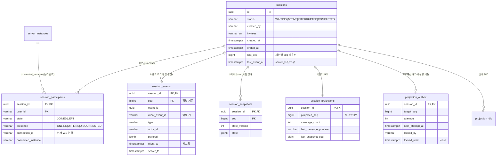

# DB 설계 · 쿼리 최적화

DDL 원본: [`src/main/resources/db/migration/V1__init.sql`](../src/main/resources/db/migration/V1__init.sql) (Flyway)

## 1. ERD



## 2. 핵심 DDL

```sql
CREATE TABLE session_events (
    session_id      uuid        NOT NULL REFERENCES sessions (id),
    seq             bigint      NOT NULL,      -- 세션 내 정렬의 유일한 기준(서버 부여)
    event_id        uuid        NOT NULL,
    client_event_id varchar(80) NOT NULL,      -- 멱등 키
    type            varchar(32) NOT NULL,
    actor_id        varchar(64) NOT NULL,
    payload         jsonb       NOT NULL DEFAULT '{}'::jsonb,
    client_ts       timestamptz,               -- 참고용(정렬에 쓰지 않음)
    server_ts       timestamptz NOT NULL,      -- seq 와 함께 비감소
    PRIMARY KEY (session_id, seq)
);
CREATE UNIQUE INDEX uq_events_idempotency ON session_events (session_id, actor_id, client_event_id);
CREATE INDEX idx_events_session_ts ON session_events (session_id, server_ts, seq);
CREATE INDEX idx_events_message_ops ON session_events (session_id, ((payload ->> 'targetSeq')::bigint))
    WHERE type IN ('MESSAGE_EDITED', 'MESSAGE_DELETED');

CREATE TABLE sessions (
    id uuid PRIMARY KEY, title varchar(200), status varchar(16) NOT NULL, created_by varchar(64) NOT NULL,
    invitees varchar(64)[] NOT NULL DEFAULT '{}', created_at timestamptz NOT NULL, ended_at timestamptz,
    last_seq bigint NOT NULL DEFAULT 0, last_event_at timestamptz NOT NULL
);
CREATE INDEX idx_sessions_status_created ON sessions (status, created_at DESC, id DESC);
CREATE INDEX idx_sessions_created       ON sessions (created_at DESC, id DESC);

CREATE TABLE session_participants (
    session_id uuid NOT NULL REFERENCES sessions (id), user_id varchar(64) NOT NULL,
    state varchar(16) NOT NULL, presence varchar(16) NOT NULL,
    joined_at timestamptz NOT NULL, left_at timestamptz, last_seen_at timestamptz NOT NULL,
    connection_id varchar(64), connected_instance varchar(64),
    PRIMARY KEY (session_id, user_id)
);
CREATE INDEX idx_participants_user ON session_participants (user_id, session_id);
CREATE INDEX idx_participants_instance ON session_participants (connected_instance) WHERE connection_id IS NOT NULL;

CREATE TABLE session_snapshots (
    session_id uuid NOT NULL REFERENCES sessions (id), seq bigint NOT NULL,
    state_version int NOT NULL, state jsonb NOT NULL, event_count int NOT NULL, created_at timestamptz NOT NULL,
    PRIMARY KEY (session_id, seq)
);
```

## 3. 모델링 선택과 트레이드오프

| 결정 | 이유 | 트레이드오프 |
|---|---|---|
| **이벤트 단일 테이블 + `payload jsonb`** | 이벤트 타입이 늘어도 스키마 변경 없음. 리플레이는 seq 순으로 한 테이블만 읽으면 됨 | 타입별 컬럼 제약을 DB 가 강제하지 못함 → 쓰기 경로(`EventAppender`)에서 payload 를 **정규화**(허용 필드만 저장)하고 리듀서는 결정적으로 해석 |
| **PK = `(session_id, seq)`** (서로게이트 bigserial 없음) | 리플레이/resume/디버깅 조회가 모두 "세션의 seq 구간" 이므로 PK 범위 스캔 한 번에 끝남. 세션 내 순서가 PK 로 보장됨 | 전역 순서가 없음(필요 없음). 전역 CDC 가 필요하면 별도 시퀀스/LSN 사용 |
| **쓰기 모델(`sessions`, `session_participants`)을 이벤트와 같은 트랜잭션에서 갱신** (비정규화) | 명령 검증(참여 여부, 정원, 종료 여부)과 목록 필터를 리플레이 없이 O(1)로 처리. 강한 일관성 | 같은 사실이 두 곳에 있음. 둘 다 `SessionStatus.derive` 한 규칙을 쓰고, 테스트가 "head 리플레이 상태 == 쓰기 모델" 을 확인 |
| **비동기 프로젝션(`session_projections`)** | 메시지 수, 미리보기처럼 정확한 실시간성이 필요 없는 요약은 쓰기 경로에서 분리 | 최종적 일관성(`summary.lag` 노출) |
| **스냅샷 `jsonb` + `state_version`** | 상태 형식 변경 시 버전을 올리면 옛 스냅샷은 무시하고 전체 리플레이로 자동 우회 | TOAST 압축으로 저장은 작지만(5,000 이벤트 세션 최대 55KB), 역직렬화 비용은 메시지 수에 비례([event-sourcing.md](event-sourcing.md#측정-결과와-한계)) |
| **`invitees varchar[]`** | 1:1 이라 최대 2명. 별도 테이블보다 단순 | 초대 대상으로 검색하는 요구가 생기면 GIN 인덱스나 정규화 필요 |
| **enum 대신 varchar** | 마이그레이션 없이 값 추가 가능 | 오타 방지는 애플리케이션 enum 이 담당 |

## 4. 주요 쿼리와 인덱스 근거 (핫패스)

측정 환경: 세션 2,000개 × 이벤트 500개 + 부하 테스트 데이터 = **이벤트 약 158만 건(테이블+인덱스 586MB)**, Docker PostgreSQL 17, `EXPLAIN (ANALYZE, BUFFERS)`.

### Q1. 리플레이 / 재연결 resume / 빈틈 메우기 — 가장 자주 실행

```sql
SELECT * FROM session_events
 WHERE session_id = :sid AND seq > :after AND seq <= :to
 ORDER BY seq LIMIT 1000;
```
```
Limit (actual time=1.428..1.443 rows=200)
  -> Sort  Sort Key: seq  (quicksort 76kB)
     -> Bitmap Heap Scan on session_events  Heap Blocks: exact=200
        -> Bitmap Index Scan on session_events_pkey
             Index Cond: (session_id = ...) AND (seq > 300) AND (seq <= 500)
Execution Time: 1.556 ms
```
- **인덱스**: PK `(session_id, seq)` 범위 스캔. 세션 전체 크기와 무관하게 **읽는 구간만큼만** 비용이 든다.
- **병목**: `Heap Blocks: exact=200`, 즉 200행에 200블록을 읽었다. 여러 세션의 이벤트가 동시에 append 되면서 한 세션의 이벤트가 힙 곳곳에 흩어지기 때문이다(실서비스에서도 동시 대화가 많을수록 심해짐). 캐시에 없으면 행마다 랜덤 I/O 가 된다.
- **개선**: ① `session_id` 해시 파티셔닝(파티션당 크기 감소 + 파티션 단위 VACUUM/CLUSTER) ② 오래된 파티션은 `CLUSTER ... USING pkey` 로 물리 재배치 ③ 리플레이 컬럼만 담은 커버링 인덱스(`INCLUDE (type, actor_id, payload, server_ts)`)로 Index Only Scan. 단 인덱스가 테이블 크기만큼 커지는 비용이 있다 ④ 스냅샷으로 읽는 구간 자체를 줄인다.

### Q2. `timeline?at=` 시각 → seq 변환

```sql
SELECT seq FROM session_events
 WHERE session_id = :sid AND server_ts <= :at
 ORDER BY server_ts DESC, seq DESC LIMIT 1;
```
```
Limit (actual time=0.054..0.055 rows=1)
  -> Index Only Scan Backward using idx_events_session_ts   Heap Fetches: 0
Execution Time: 0.067 ms
```
- **인덱스**: `(session_id, server_ts, seq)`. `seq` 를 키 끝에 넣어 **Index Only Scan, 역방향 1행**으로 끝난다.
- `server_ts` 가 seq 와 함께 비감소하도록 쓰기 시 보정(`max(now, last_event_at)`)했기 때문에 "시각 이하의 마지막 행 = 그 시각의 상태" 가 성립한다.

### Q3. 세션 목록 (상태/참여자/기간 + 키셋 페이지네이션)

```sql
SELECT s.* FROM sessions s
 WHERE s.status = :status AND s.created_at >= :from
   AND EXISTS (SELECT 1 FROM session_participants p WHERE p.user_id = :user AND p.session_id = s.id)
   AND (s.created_at, s.id) < (:cursorCreatedAt, :cursorId)
 ORDER BY s.created_at DESC, s.id DESC LIMIT 21;
```
```
-- 참여자 필터: 사용자의 세션을 먼저 찾고 PK 로 조인
Nested Loop
  -> Index Only Scan Backward using idx_participants_user   (user_id = 'bench-u1000')
  -> Index Scan using sessions_pkey   Filter: status = 'ACTIVE'
Execution Time: 0.172 ms

-- 상태 + 기간 + 커서(2페이지 이후)
Limit -> Index Scan using idx_sessions_status_created
         Index Cond: status = 'ACTIVE' AND created_at >= ... AND ROW(created_at, id) < ROW(...)
Execution Time: 0.201 ms
```
- **키셋 페이지네이션**: `OFFSET` 은 깊은 페이지일수록 앞 행을 모두 읽고 버린다. `(created_at, id)` 커서는 몇 페이지든 **인덱스 위치로 바로 점프**한다. 행 비교 `(a, b) < (x, y)` 가 인덱스 조건으로 들어가 정렬 단계도 없다.
- 페이지에 딸린 참여자/요약은 `IN (...)` 쿼리 2번으로 한꺼번에 가져온다(N+1 방지).
- 참여자 필터는 사용자당 세션 수가 적다는 가정(선택도 높음)에서 participants 를 드라이빙 테이블로 쓴다. 사용자당 세션이 수만 개라면 `session_participants` 에 `created_at` 을 비정규화하고 `(user_id, created_at DESC)` 인덱스를 둔다.

### Q4. 멱등 키 조회 / 수정·삭제 대상 검증 (쓰기 핫패스)

```
Index Scan using uq_events_idempotency    Execution Time: 0.097 ms
Index Scan using idx_events_message_ops   Execution Time: 0.309 ms   -- 부분 표현식 인덱스(16kB)
```
- `idx_events_message_ops` 는 **수정/삭제 이벤트에만** 거는 부분 인덱스라 이벤트 158만 건 기준 크기가 16kB 다. 전체 이벤트에 `payload->>'targetSeq'` 인덱스를 걸면 대부분이 NULL 인 거대한 인덱스가 된다.

### Q5. 쓰기 핫패스: 이벤트 저장 (writable CTE)

```sql
WITH ev AS (INSERT INTO session_events (...) VALUES (...)),
     s  AS (UPDATE sessions SET last_seq = :seq, last_event_at = :ts, status = :status WHERE id = :sid),
     o  AS (INSERT INTO projection_outbox (...) VALUES (...)
            ON CONFLICT (session_id) DO UPDATE SET target_seq = GREATEST(projection_outbox.target_seq, EXCLUDED.target_seq))
SELECT 1;
```
트랜잭션 하나의 왕복은 `세션 FOR UPDATE` → `멱등 키 조회` → `참여자 조회` → **(CTE 1문장)** → `COMMIT` 으로 5번이다. 원래 8번(이벤트, 세션, outbox 각각 + 참여자 last_seen 갱신)이었다. 부하 테스트에서 병목은 DB CPU(5%)가 아니라 **커넥션 점유 시간(왕복 지연 + 커밋 fsync)** 이었기 때문에 왕복 수를 줄이는 것이 직접적인 효과를 냈다(250 세션 ack p95 617ms → 97ms, [load-test.md](load-test.md)).

### 인덱스 크기 (이벤트 158만 건)

| 인덱스 | 크기 | 용도 |
|---|---|---|
| `session_events_pkey` | 99 MB | 리플레이, resume, 빈틈 메우기 |
| `uq_events_idempotency` | 119 MB | 멱등성 |
| `idx_events_session_ts` | 122 MB | at → seq |
| `idx_events_message_ops` | 16 kB | 수정/삭제 검증(부분 인덱스) |

## 5. 대화 데이터가 대량으로 쌓일 때의 조회 성능 전략

데이터가 늘어도 **핫패스 조회 비용이 "전체 데이터 크기" 가 아니라 "읽어야 하는 구간 크기" 에만 비례**하도록 설계했다.

| 조회 | 전략 | 비용 |
|---|---|---|
| 실시간 resume / 빈틈 메우기 | PK `(session_id, seq)` 범위 스캔 + `LIMIT` 페이지 | O(놓친 이벤트 수) |
| 특정 시점 복원 | ① at→seq 는 Index Only Scan 1행 ② 스냅샷 1행 ③ 이후 이벤트 ≤ interval-1 개 | O(스냅샷 + interval), 세션 길이와 무관 |
| 세션 목록 | 키셋 페이지네이션 + `(status, created_at, id)` 인덱스, 페이지당 IN 쿼리 2번 | O(페이지 크기), 페이지 깊이와 무관 |
| 대화창 최근 N개 | 복원 결과에서 마지막 N개만 응답(`messageLimit`, 최대 500) | 응답 크기 제한 |
| 디버깅 조회 | `afterSeq` 커서 + `LIMIT ≤ 1000` | 무제한 스캔 금지 |
| 목록 요약(메시지 수, 미리보기) | 비동기 프로젝션 테이블에서 바로 읽음(집계 쿼리 없음) | O(1) |

규모가 더 커질 때의 순서(아래 §6 병목과 연결):
1. **파티셔닝**: `session_events` 를 `session_id` 해시로 나눈다. 인덱스 깊이와 VACUUM 범위가 줄고, 같은 세션의 이벤트가 한 파티션에 모여 지역성이 좋아진다.
2. **아카이빙**: 종료 후 오래된 세션은 이벤트를 콜드 스토리지로 옮기고 최종 스냅샷만 남긴다.
3. **읽기 분리**: timeline, events 조회를 리플리카로 보낸다.
4. **메시지 시간축 프로젝션**: 스냅샷 크기를 메시지 수와 분리한다([event-sourcing.md §6](event-sourcing.md#6-개선-설계-시간축-메시지-프로젝션)).

## 6. 예상 병목과 개선 방향

1. **이벤트 테이블 증가** (가장 먼저 옴): 인덱스 3개가 테이블만큼 크다. ① `session_id` 해시 파티셔닝(예: 32개) ② 종료 후 N일 지난 세션의 이벤트는 콜드 스토리지(S3 Parquet)로 아카이빙하고, 최종 스냅샷만 남겨 복원은 "스냅샷까지" 로 제한한다.
2. **멱등 인덱스 비용**: 키가 길다(uuid + 사용자 + 문자열 키). ① 클라이언트 키를 UUID 로 강제해 `uuid` 타입(16B)으로 저장 ② 멱등 보장 기간을 7일로 한정하고 별도 테이블(`idempotency_keys`, 기간 파티션 DROP)로 분리하면 이벤트 테이블 인덱스 하나를 줄일 수 있다.
3. **세션 행 잠금 경합**: 1:1 이라 경합은 작다. 단체방으로 확장하면 seq 부여를 Redis `INCR` 이나 파티션 리더(세션 → 단일 writer)로 옮긴다.
4. **커넥션 풀 고갈**: 인스턴스 수 × 풀 크기 ≤ `max_connections` 를 맞춰야 한다. 인스턴스를 많이 늘릴 계획이면 PgBouncer(transaction pooling)를 앞에 둔다. 트랜잭션 안에서 외부 I/O 를 하지 않는 원칙을 유지한다(현재도 Redis 발행은 커밋 후).
5. **스냅샷 크기**: 모든 메시지를 담기 때문에 메시지 수에 비례해 커진다. 장기 대화가 많아지면 메시지를 시간축 프로젝션 테이블로 분리한다([event-sourcing.md](event-sourcing.md#6-개선-설계-시간축-메시지-프로젝션)).
6. **읽기 부하**: `timeline`, `events` 조회는 읽기 전용 트랜잭션이라 리플리카로 보낼 수 있다(리플리카 지연이 있어도 "그 seq 까지의 상태" 라 정합성 문제 없음, 다만 head 복원은 지연만큼 오래된 값일 수 있음).
