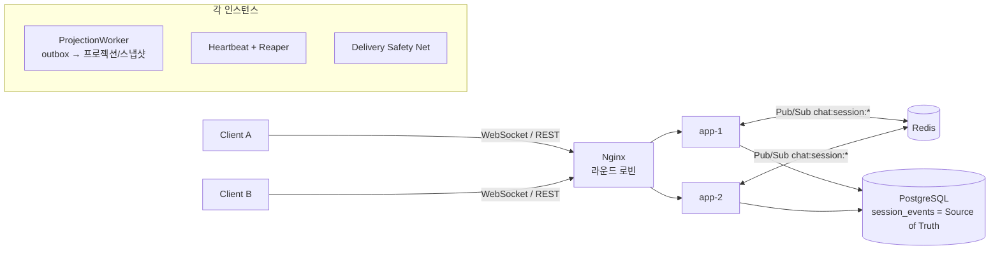
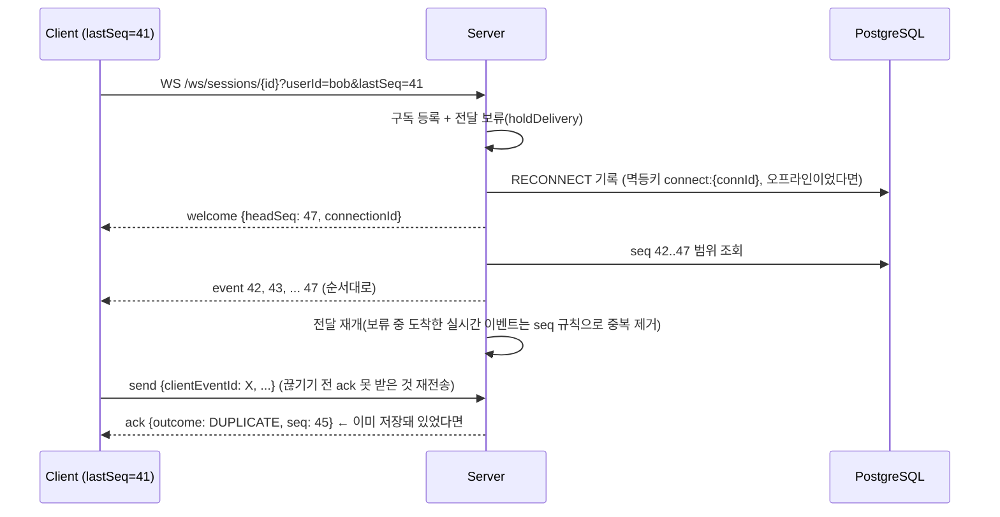

# 설계 문서

> 재연결 · 중복 처리 · 순서 · 수평 확장 · 비동기 처리 · 관측 가능성 · 장애 대응
> (DB/쿼리는 [database.md](database.md), 상태 복원은 [event-sourcing.md](event-sourcing.md), 부하 테스트는 [load-test.md](load-test.md))

## 1. 전체 구조

| 구성 요소 | 역할 | 상태 보관 |
|---|---|---|
| `EventAppender` | 이벤트 추가의 **유일한 쓰기 경로**. 세션 행 잠금 → 멱등 검사 → 검증 → seq 부여 → 저장 + outbox | PostgreSQL |
| `session_events` | append-only 이벤트 로그. 모든 상태의 진실 원천 | PostgreSQL |
| `sessions`, `session_participants` | 명령 검증용 **쓰기 모델**(현재 상태). 이벤트와 같은 트랜잭션에서 갱신(강한 일관성) | PostgreSQL |
| `session_projections`, `session_snapshots` | **읽기 모델**. 비동기 워커가 갱신(최종적 일관성) | PostgreSQL |
| `SessionBroadcaster` | 커밋된 이벤트를 다른 인스턴스로 전달(at-most-once) | Redis Pub/Sub(휘발성) |
| `ClientConnection` | 연결별 순서 보장/빈틈 메우기/재정렬 버퍼 | 인스턴스 메모리(재구성 가능) |

**핵심 원칙**: 인스턴스 메모리와 Redis에는 "잃어도 되는 것"만 둔다. 이벤트는 커밋된 뒤에만 브로드캐스트하고, 클라이언트가 받는 모든 이벤트는 DB에 있다. 그래서 어떤 인스턴스나 Redis가 죽어도 `lastSeq` 기반 resume으로 정확히 복구할 수 있다.

### 기술 선택 근거

| 선택 | 이유 | 버린 대안 |
|---|---|---|
| Java 21 + Spring Boot 4.1 | 팀/면접 공통 언어, WebSocket·JDBC·Actuator·Micrometer 생태계 성숙 | Node(NestJS): 단일 스레드 이벤트 루프로 리플레이 같은 CPU 작업과 I/O 가 섞임 |
| PostgreSQL | 트랜잭션 + 행 잠금으로 **세션 단위 seq 직렬화**를 단순하게 구현, JSONB, 부분/표현식 인덱스, `FOR UPDATE SKIP LOCKED` 큐 | Kafka 같은 로그 저장소: 세션 단위 순서는 파티션 키로 해결되지만 멱등 검사·조회·복원 API를 위해 별도 저장소가 또 필요해 과제 범위에 비해 운영 부담이 큼 |
| JdbcClient(SQL 직접) | 이벤트 저장/범위 조회/CTE 등 **쿼리를 그대로 통제**하고 실행 계획으로 설명하기 위해 | JPA: 영속성 컨텍스트, 지연 로딩이 append-only 로그 모델에 이점이 적음 |
| 순수 WebSocket + 자체 JSON 프로토콜 | seq/ack/resume 을 직접 제어해야 함 | STOMP: 브로커 의미론(구독/ack)이 이 요구와 다르고 resume 을 따로 구현해야 함 |
| Redis Pub/Sub | 인스턴스 간 fan-out 이 가볍고 지연이 낮음. 유실돼도 DB 로 복구하므로 내구성이 필요 없음 | Redis Streams/Kafka: 내구성 있는 전달은 DB 가 이미 보장하므로 중복 투자 |

---

## 2. 순서 보장 (순서 뒤바뀜 대응)

### 2.1 정렬 기준: 서버가 부여하는 세션별 `seq`
- 세션 행을 `SELECT ... FOR UPDATE` 로 잠그고 `seq = last_seq + 1` 을 부여한다. 그래서 **세션 내 seq 는 빈틈없이 단조 증가**한다.
- **클라이언트 시각(`clientTs`)은 저장만 하고 정렬에 쓰지 않는다.** 기기 시계는 틀릴 수 있고 조작될 수도 있기 때문이다.
- `server_ts = max(now, sessions.last_event_at)` 로 부여해서, 인스턴스 간 시계 오차가 있어도 **seq 순서와 시각 순서가 같은 방향**이 되게 한다. 덕분에 `timeline?at=` 을 seq 로 결정적으로 바꿀 수 있다.
- 부수 효과로 중요한 불변식이 생긴다. **"seq N 이 커밋됐다면 N 미만은 모두 이미 커밋됐다."** (행 잠금이 커밋까지 유지되기 때문) 실시간 전송의 빈틈은 언제나 DB 로 메울 수 있다.

**트레이드오프**: 세션 하나의 쓰기는 직렬화된다. 1:1 대화는 세션당 쓰기 빈도가 낮아(초당 수 건) 문제되지 않고, 세션끼리는 서로 막지 않는다. 단체방처럼 세션당 쓰기가 많아지면 이 행이 핫스팟이 되므로, 시퀀스를 Redis `INCR` 이나 세션 단위 단일 writer(파티션 리더)로 옮겨야 한다.

### 2.2 클라이언트 → 서버 방향의 순서 뒤바뀜
| 상황 | 처리 |
|---|---|
| 서로 독립적인 메시지 A, B 가 B→A 순으로 도착 | 도착(커밋) 순서대로 seq 부여. "서버가 받은 순서" 가 대화의 정답이며 모든 참여자가 같은 순서를 본다 |
| **수정/삭제가 원본보다 먼저 도착** | `TARGET_NOT_FOUND`(422, `retryable=true`) 로 거절. 클라이언트가 같은 `clientEventId` 로 재시도하면 원본 저장 뒤 정상 반영 |
| 오래된 READ(읽음 위치)가 늦게 도착 | `lastReadSeq = max(현재, upToSeq)` 라 되돌아가지 않음(교환/멱등 연산) |
| 배치 수집 `POST /events` | 배열 순서대로 처리하고 항목별 결과를 반환. 앞 항목 실패가 뒤 항목을 막지 않음 |

인과관계가 있는 이벤트(수정→원본)만 거절하고 나머지는 서버 도착 순서를 정답으로 둔다. "클라이언트 시퀀스 기반 홀드백 버퍼(누락된 앞 번호가 올 때까지 서버가 보류)" 도 검토했지만, 서버에 연결별 상태와 타임아웃이 생기고 수평 확장 시 그 상태를 공유해야 해서 채택하지 않았다.

### 2.3 서버 → 클라이언트 방향의 순서 (`ClientConnection`)
- 연결마다 `lastSentSeq` 를 두고 **seq 순서대로, 빈틈 없이, 한 번씩** 보낸다.
- `seq <= lastSentSeq` → 버림(중복 브로드캐스트, resume 과 실시간 전송의 겹침).
- `seq > lastSentSeq + 1` → **재정렬 버퍼**에 100ms 보관. 인스턴스 간 publish 순서가 뒤바뀐 경우라면 빠진 이벤트가 곧 도착한다. 그래도 빈틈이면 DB(`PK 범위 조회`)에서 메운다.
- 메일박스(actor) 방식: 수신 스레드는 큐에 넣기만 하고 전달 풀이 연결별로 하나씩 비운다. 느린 클라이언트가 다른 연결을 막지 않는다.

---

## 3. 중복 처리 (멱등성)

| 계층 | 장치 |
|---|---|
| 저장 | `UNIQUE(session_id, actor_id, client_event_id)`. 세션 행 잠금 안에서 먼저 조회하고, 있으면 **저장/반영 없이 처음 결과(seq)를 그대로 반환**(`DUPLICATE`). 유니크 인덱스는 최후 방어선 |
| 서버 생성 이벤트 | 결정적 멱등 키: `connect:{connectionId}`, `disconnect:{connectionId}`, `end:{sessionId}`, `create:{sessionId}`. 연결 종료 핸들러와 장애 정리(reaper)가 동시에 DISCONNECT 를 기록하려 해도 한 번만 남음 |
| 상태 기반 멱등 | 이미 참여 중인 JOIN, 이미 ONLINE 인 연결 인계는 이벤트를 남기지 않음(`SKIPPED`) |
| 브로드캐스트 | 연결 측 `lastSentSeq` 로 중복 제거 |
| 프로젝션 | 체크포인트(`projected_seq`)보다 큰 이벤트만 반영. 반영과 체크포인트 갱신이 같은 트랜잭션 |
| 스냅샷 | `PK(session_id, seq)` + `ON CONFLICT DO NOTHING`. 같은 seq 의 스냅샷은 결정적으로 동일 |
| 리플레이 | 리듀서는 `seq <= state.seq` 이벤트를 무시(재적용 멱등), seq 빈틈은 예외로 처리(조용히 틀린 상태를 만들지 않음) |

멱등 키 범위를 `(세션, 사용자)` 로 둔 이유: 세션 범위로만 두면 다른 사용자가 같은 키를 보냈을 때 남의 이벤트가 "중복" 으로 반환되는 정보 노출이 생긴다.

**멱등 키 보존 기간**: 이벤트 로그 자체가 멱등 키 저장소라 영구 보존된다. 대신 유니크 인덱스가 크다(이벤트 100만 건 기준 119MB, PK 보다 큼). 대안은 [database.md](database.md#6-예상-병목과-개선-방향)에 정리했다.

---

## 4. 재연결과 데이터 정합성

1. **resume**: 클라이언트는 마지막으로 받은 `seq` 를 `lastSeq` 로 보낸다. 서버는 그 뒤 이벤트를 DB 에서 순서대로 보낸 다음 실시간 전송으로 넘어간다. 연결 수립 도중 생긴 이벤트는 "구독을 먼저 등록하고 전달을 보류" 하는 방식으로 놓치지 않는다.
2. **at-least-once 전송 + 멱등 저장 = effectively-once**: 클라이언트는 ack 를 못 받은 전송을 같은 `clientEventId` 로 재전송한다. 이미 저장된 것이면 `DUPLICATE` 와 처음의 seq 가 돌아온다.
3. **presence**: 연결이 끊기면 `DISCONNECT`(presence=`DISCONNECTED`, 세션=`INTERRUPTED`), 다시 붙으면 `RECONNECT`(→ `ACTIVE`). 둘 다 이벤트라서 **"그때 상대가 끊겨 있었는지" 도 복원된다.**
4. **늦게 도착한 종료 신호 무시**: DISCONNECT 는 "그 연결이 아직 참여자의 현재 연결일 때만" 기록한다. 새 연결이 먼저 붙은 뒤(빠른 재연결, 다른 인스턴스로 이동) 옛 연결의 종료가 도착해도 상태가 뒤집히지 않는다.
5. **같은 사용자의 중복 연결**: 새 연결이 생기면 `REPLACED` 브로드캐스트로 다른 인스턴스에 남은 옛 연결을 4001 로 닫는다(DISCONNECT 이벤트 없음).
6. **유실 대비 이중 장치**: (a) 클라이언트 `ping` 응답의 `headSeq` > `lastSeq` 이면 클라이언트가 `resume` 을 요청하고, (b) 서버 안전망이 2초마다 로컬 연결의 head 를 한 번에 조회해 뒤처진 연결을 따라잡게 한다(Pub/Sub 유실 후 이벤트가 더 오지 않는 "대화의 마지막 메시지" 문제).

---

## 5. 수평 확장: 세션 분산과 상태 저장

- **세션 상태는 인스턴스에 두지 않는다.** 그래서 sticky session 이 필요 없다. 같은 세션의 두 참여자가 서로 다른 인스턴스에 붙어도 된다(데모: `alice@app-1`, `bob@app-2`).
- **쓰기 일관성**: 어느 인스턴스로 오든 세션 행 잠금으로 직렬화된다.
- **fan-out**: 커밋 후 `chat:session:{id}` 로 publish 하고, 각 인스턴스는 기동 시 `chat:session:*` 를 패턴 구독해 로컬 연결이 있는 세션만 처리한다.
  - 처음에는 "로컬 연결이 생길 때 세션 채널을 동적으로 구독" 했다. 그런데 부하 테스트에서 동시 구독 요청이 겹치면 구독이 누락되는 현상이 재현되어(전달 p95 1.8초) 패턴 구독으로 바꿨다(→ p95 14ms). 경위는 [load-test.md](load-test.md#3-병목-추적-과정)에 있다.
  - 대가는 모든 인스턴스가 모든 메시지를 받는 것(비용이 인스턴스 수에 비례). 수십 대 규모라면 **Redis 7 Sharded Pub/Sub(`SSUBSCRIBE`)** 이나 "세션 → 인스턴스" 라우팅 테이블(consistent hashing)로 해당 세션의 연결이 있는 인스턴스에만 보낸다.
- **백그라운드 작업 분산**: 프로젝션 워커는 모든 인스턴스에서 돌고, outbox 를 `FOR UPDATE SKIP LOCKED` + lease 로 나눠 가진다(리더 선출 불필요). reaper 는 결정적 멱등 키라 여러 인스턴스가 동시에 돌아도 안전하다.
- **확장 한계와 다음 단계**: 병목은 DB 왕복과 커넥션 풀이다(부하 테스트로 확인). 다음 순서로 대응한다. ① 쓰기 왕복 줄이기(적용: CTE 로 3→1) ② 읽기를 리플리카로 분리(timeline, events 조회) ③ `session_events` 를 `session_id` 해시 파티셔닝 ④ 세션 ID 기준 DB 샤딩.

---

## 6. 비동기 처리 구조 (Projection, Snapshot, 재시도, DLQ, Idempotency)

```mermaid
flowchart LR
    subgraph TX[이벤트 저장 트랜잭션]
      E[session_events INSERT] --- O[projection_outbox UPSERT<br/>세션당 1행, target_seq=max]
    end
    O --> CL{claim<br/>SKIP LOCKED + lease 30s}
    CL --> P[project&#40;session&#41;<br/>체크포인트 이후만 반영<br/>+ N의 배수 seq 마다 스냅샷]
    P -- 성공 --> D[outbox 삭제<br/>처리 중 새 이벤트가 있으면 lease 만 해제]
    P -- 실패 --> RT{attempts < max?}
    RT -- 예 --> B[지수 백오프 + jitter 후 재시도]
    RT -- 아니오 --> DLQ[projection_dlq] --> RD[원인 해결 후 /admin/.../redrive]
```

- **Transactional Outbox**: 이벤트와 outbox 행이 같은 트랜잭션이라 "이벤트는 있는데 프로젝션 신호가 유실" 되는 부분 실패가 없다. outbox 는 세션당 1행으로 신호를 합친다(coalescing). 메시지가 100개 와도 워커 작업은 1건이다.
- **중복 실행 방지**: `UPDATE ... WHERE session_id IN (SELECT ... FOR UPDATE SKIP LOCKED)` 로 claim 하고 `locked_until` lease 를 건다. 워커가 죽으면 lease 만료 후 다른 워커가 가져간다. 그래도 같은 세션을 두 워커가 동시에 처리하는 경우(lease 만료 직후 원래 워커가 살아남은 경우)는 `session_projections` 행 잠금으로 직렬화되고, **체크포인트 멱등성** 덕분에 두 번째 실행은 아무것도 하지 않는다.
- **재시도**: 지수 백오프 + jitter(`exp = min(max, base·2^(n-1))`, 지연 = `exp/2 + rand(exp/2)`)로 동시 재시도 폭주를 막는다.
- **DLQ**: `max-attempts`(기본 5)를 넘기면 `projection_dlq` 로 옮기고 outbox 에서 뺀다(다른 세션 처리를 막지 않음). 원인을 해결한 뒤 redrive 하면 다시 처리된다. **DLQ 에 가도 이벤트는 그대로이고 timeline 복원은 이벤트에서 직접 하므로 영향이 없다.** 늦어지는 것은 목록 요약뿐이다.
- **스냅샷 자동화**: seq 가 interval(기본 100)의 배수인 지점마다, 그리고 세션 종료 시점에 만든다. 위치가 워커 실행 타이밍과 무관하게 정해지므로, 과거 어느 시점을 복원하든 리플레이는 최대 interval-1 개다.
- **동기/비동기 경계**: 명령 검증에 필요한 것(참여자, presence, 세션 상태)은 동기로 처리해 강한 일관성을 유지한다. 목록 요약(메시지 수, 미리보기)과 스냅샷은 비동기라 최종적 일관성이다. API 응답에 `summary.projectedSeq`, `summary.lag` 를 노출해서 클라이언트도 반영 지연을 알 수 있다.
- **장애 주입 테스트**: `ProjectionFaultInjector` 로 특정 세션의 프로젝션을 실패시키는 테스트가 있다(재시도 → DLQ → redrive 후 정상화, `TimelineAndProjectionIntegrationTest`).

---

## 7. 관측 가능성

### 로그
- 모든 로그 줄에 `requestId`(HTTP `X-Request-Id`, 없으면 생성해서 응답 헤더로 반환), `sessionId`, `userId` 를 MDC 로 붙인다. WebSocket 은 `requestId = ws-{connectionId}` 다. **"이 사용자의 이 세션에서 무슨 일이 있었나" 를 grep 한 번으로 추적할 수 있다.**
- 이벤트 로그 자체가 감사(audit) 로그다. `GET /sessions/{id}/events` 로 seq 순 원본을 그대로 볼 수 있다.

### 메트릭 (Micrometer → `/actuator/prometheus`)
| 메트릭 | 의미 / 알림 기준 예 |
|---|---|
| `chat_events_ingested_total{type,outcome}` | 수집률. `DUPLICATE` 비율 급증 = 클라이언트 재전송 폭주(네트워크 문제) |
| `chat_events_rejected_total{type,code}` | 거절 사유. `TARGET_NOT_FOUND` 증가 = 순서 뒤바뀜 증가 |
| `chat_events_append_seconds` (histogram) | 저장 지연. p99 > 200ms 알림 |
| `chat_ws_connections`, `chat_ws_sessions` | 인스턴스별 연결 수(분산 편향 확인) |
| `chat_projection_outbox_pending`, `chat_projection_lag_max` | 비동기 적체. 지속 증가 = 워커 처리량 부족 |
| `chat_projection_dlq` | 0 이 아니면 즉시 알림 |
| `chat_projection_processed_total{result}` | success / retry / dlq |
| `chat_timeline_restore_seconds{strategy}`, `chat_timeline_replayed_events_total` | 복원 비용. 스냅샷 주기 튜닝 근거 |
| `chat_presence_reaped_total` | 장애 인스턴스 정리 건수(> 0 = 인스턴스 비정상 종료) |
| `chat_broadcast_failures_total`, `chat_delivery_resync_total` | Redis 발행 실패, 안전망 재동기화 |
| `hikaricp_connections_active/pending`, `http_server_requests_seconds` | 커넥션 고갈, 5xx 비율 |

Grafana 대시보드(`infra/grafana/dashboards/chat.json`)는 자동 프로비저닝된다. 캡처는 [load-test.md](load-test.md#4-운영-대시보드)에 있다.

### 추적
- 현재는 `requestId` 기반 상관관계까지만 구현했다. 운영에서는 `micrometer-tracing-bridge-otel` 로 W3C `traceparent` 를 HTTP → 이벤트 payload(메타데이터) → Redis envelope → 전달까지 전파한다. 그러면 **"보낸 메시지가 상대에게 도착하기까지" 의 스팬**(append → commit → publish → deliver)을 한 트레이스로 볼 수 있다. 이벤트에 `traceId` 를 저장하면 리플레이/감사 시점에도 원 요청을 찾을 수 있다.

---

## 8. 장애 대응 시나리오 (감지 → 완화 → 복구)

### 8.1 서버 다운(인스턴스 장애)
| 단계 | 내용 |
|---|---|
| **감지** | ① LB 헬스체크(`/actuator/health/readiness`) 실패 ② 인스턴스 하트비트(`server_instances.heartbeat_at`, 5초 주기)가 `instance-timeout`(20초) 이상 끊김 ③ 대시보드에서 해당 인스턴스 연결 수가 0으로 급락, 다른 인스턴스 연결 수 급증 |
| **완화** | ① 클라이언트는 연결 끊김을 감지하고 지수 백오프로 재연결하며 `lastSeq` 로 resume. LB 가 살아 있는 인스턴스로 보낸다 ② ack 를 못 받은 전송은 같은 `clientEventId` 로 재전송한다. 이미 커밋된 것은 `DUPLICATE`, 커밋 전에 죽은 것은 트랜잭션 롤백으로 저장되지 않았으므로 새로 저장된다(**부분 저장 없음**) ③ 살아 있는 인스턴스의 **reaper 가 죽은 인스턴스의 연결을 `DISCONNECT(reason=INSTANCE_DOWN)` 로 기록**한다. 상대방에게 "연결 끊김" 이 보이고 세션은 `INTERRUPTED` 가 된다 |
| **복구** | ① 재연결하면 `RECONNECT` → `ACTIVE` ② 죽은 인스턴스가 들고 있던 outbox lease 는 30초 뒤 만료되어 다른 워커가 이어서 처리한다 ③ 인스턴스 재기동 후 하트비트가 재개된다. 정상 종료(배포)라면 `@PreDestroy` 에서 연결을 1001 로 닫아 클라이언트가 즉시 재연결한다 |
| **검증** | `node scripts/chaos-instance-down.mjs`: app-2 를 `docker kill` → 21초 뒤 bob 이 `DISCONNECTED(INSTANCE_DOWN)`, 세션 `INTERRUPTED` → LB 로 재연결하자 `ACTIVE`. 통합 테스트 `reaperDisconnectsConnectionsOfDeadInstances` |

### 8.2 DB 장애 또는 성능 저하 (커넥션 고갈, 락 경합)
| 단계 | 내용 |
|---|---|
| **감지** | `hikaricp_connections_pending > 0` 지속, `hikaricp_connections_timeout_total` 증가, `chat_events_append_seconds` p99 급등, 5xx(503) 비율 증가. DB 측은 `pg_stat_activity` 의 `wait_event_type=Lock`, `pg_stat_statements` 로 느린 쿼리 확인 |
| **완화** | ① **빨리 실패**: Hikari `connection-timeout=3s` 로 요청이 무한정 쌓이지 않게 하고, `503 + retryable=true + retryAfterSeconds` 를 응답한다. 클라이언트는 백오프 후 같은 `clientEventId` 로 재시도한다(멱등) ② **락 경합 범위 최소화**: 잠금은 세션 행 단위라 한 세션의 경합이 다른 세션에 번지지 않는다. 트랜잭션 안에서 외부 I/O(Redis 발행)를 하지 않고 커밋 후에 한다 ③ 비동기 워커는 실패해도 백오프하므로 DB 를 더 두드리지 않는다. 필요하면 워커 처리량(`chat.projection.batch-size`, `poll-interval`)을 낮춰 쓰기 경로에 커넥션을 몰아준다(프로젝션은 늦어져도 이벤트와 복원에는 영향이 없다) ④ 읽기 부하(timeline/events)는 리플리카로 우회 |
| **복구** | ① DB 가 돌아오면 Hikari 가 커넥션을 재수립한다 ② outbox 에 쌓인 프로젝션은 워커가 순차적으로 따라잡는다(`chat_projection_lag_max` 감소 확인) ③ DB 가 내려가 있던 동안 기록하지 못한 presence(DISCONNECT 기록 실패)는 다음 연결의 RECONNECT 나 인계로 바로잡힌다 |
| **실제 사례** | 부하 테스트에서 커넥션 풀 고갈을 스레드 덤프로 확인했다(Tomcat 스레드 204개가 `HikariPool.getConnection` 대기, PG CPU 5%). 쓰기 왕복 3→1(CTE), 재정렬 버퍼로 전달 측 DB 조회 제거, 풀 20→30 으로 해결했다([load-test.md](load-test.md#3-병목-추적-과정)) |

### 8.3 데이터 유실 또는 정합성 이슈 (중복 저장, 부분 실패 등)
| 단계 | 내용 |
|---|---|
| **예방** | ① 중복 저장: 멱등 키 + 유니크 인덱스 ② 부분 실패: 이벤트 + 쓰기 모델 + outbox 가 한 트랜잭션 ③ 순서 빈틈: seq 는 잠금 안에서 부여되고 롤백되면 재사용된다(시퀀스 객체와 달리 빈틈이 생기지 않음) ④ 브로드캐스트 유실: DB 가 진실 원천이고 resume, 빈틈 메우기, 안전망으로 복구 |
| **감지** | ① 리듀서가 seq 빈틈을 만나면 예외(조용히 틀린 상태를 만들지 않음) ② `mode=FULL` 복원과 `mode=AUTO`(스냅샷) 결과 비교로 스냅샷 손상 감지(테스트와 데모 스크립트가 모든 seq 에서 비교) ③ 프로젝션 대 이벤트 재계산 비교 ④ 정합성 점검 쿼리(예: `sessions.last_seq` 와 `max(session_events.seq)` 불일치) |
| **완화** | ① 손상된 스냅샷: 삭제하거나 `state_version` 을 올리면 더 이전 스냅샷/전체 리플레이로 자동 우회(결과 동일) ② 프로젝션 불일치: `POST /admin/sessions/{id}/projection/rebuild` 로 체크포인트를 0으로 되돌려 재계산(결정적) ③ DLQ 항목은 redrive |
| **복구** | 이벤트 로그가 온전하면 모든 읽기 모델(프로젝션, 스냅샷)은 **언제든 재생성 가능한 캐시**다. 이벤트 로그 자체의 손상/유실은 PostgreSQL PITR(WAL 아카이브)로 복구하고, 그 뒤 읽기 모델을 재구축한다 |

---

## 9. 가정 (Assumptions)
- 인증/인가는 비목표라 `X-User-Id` 헤더 / `userId` 쿼리로 사용자를 식별한다. 운영에서는 JWT 를 HandshakeInterceptor 와 필터에서 검증한다.
- 1:1 세션: 동시에 `JOINED` 인 참여자는 최대 2명. `invitees` 를 주면 그 사용자만 참여할 수 있고, 생략하면 선착순 2명이다. 퇴장한 사람은 재참여할 수 있다.
- 세션의 **시작**은 생성 시점(`SESSION_CREATED`, seq=1, `created_at`)이고, **종료**는 `POST /sessions/{id}/end`(`SESSION_ENDED`, `ended_at`)다. 참여자가 처음 들어온 시각은 각 참여자의 `joinedAt` 으로 따로 복원된다.
- 세션 상태는 과제의 진행중/중단/완료에 대기(WAITING)를 더했다. 상태 규칙은 `SessionStatus.derive` 하나로 쓰기 모델과 리플레이가 공유한다.
  - `COMPLETED`: 종료됨
  - `WAITING`: 참여 중인 사람 없음
  - `INTERRUPTED`: 참여자 중 누군가 연결이 끊김(DISCONNECTED)
  - `ACTIVE`: 그 외
- REST 로만 참여한 사용자의 presence 는 `OFFLINE` 이다(실시간 연결이 생기면 `ONLINE`). "중단" 은 연결이 **끊긴** 경우에만 해당한다.
- 메시지 수정/삭제는 본인 메시지만 가능하다. typing 은 저장하지 않는 휘발성 신호라 복원 대상이 아니다.
- 시각은 모두 UTC 의 `timestamptz` 이고, 마이크로초 정밀도에 맞춘다(응답 시각 = 저장 시각).

## 10. 추가 통신 방식 검토 (WebSocket vs SSE vs Long Polling vs WebRTC)

| 방식 | 장점 | 단점 | 이 과제에서 |
|---|---|---|---|
| **WebSocket** (채택) | 양방향, 낮은 오버헤드, 브라우저/모바일 지원 | LB/프록시 설정 필요(Upgrade, 타임아웃), 연결 상태 관리 | 메시지 송신 + ack + typing 이 모두 양방향이라 적합 |
| SSE | HTTP 그대로, 자동 재연결 + `Last-Event-ID`(resume 과 같은 개념) 내장 | 서버→클라이언트 단방향(송신은 REST), HTTP/1.1 에서 연결 수 제한 | 대안으로 유력하다. `Last-Event-ID = seq` 로 그대로 매핑되고, 송신은 `POST /events` 로 가능해서 **현재 설계를 거의 그대로 재사용**할 수 있다 |
| Long Polling | 어디서나 동작 | 지연과 요청 오버헤드가 큼 | 폴백 용도. `GET /events?afterSeq=` 가 이미 있어 그대로 쓸 수 있다 |
| **WebRTC DataChannel** | P2P 라 서버 대역폭 0, 매우 낮은 지연, 음성/영상으로 확장 가능 | 시그널링 서버 + STUN/TURN 필요(대칭 NAT 환경의 상당수는 TURN 경유라 결국 서버 대역폭 발생), **서버가 메시지를 보지 못하므로 이벤트 소싱/복원/감사와 충돌** | 채팅 본문에는 부적합하다. 1:1 **음성/영상 통화**를 붙인다면 WebSocket 을 시그널링 채널로 쓰고, 통화 시작/종료 같은 메타 이벤트만 이벤트 로그에 남기는 하이브리드가 맞다 |

결론: 이벤트 소싱 기반 복원이 핵심 요구라 **모든 메시지가 서버를 거치는 WebSocket** 을 유지한다. 통신 방식이 바뀌어도 `seq` / `clientEventId` / `lastSeq` 계약은 그대로 재사용할 수 있게 설계했다(SSE, Long Polling 폴백이 쉬움).
