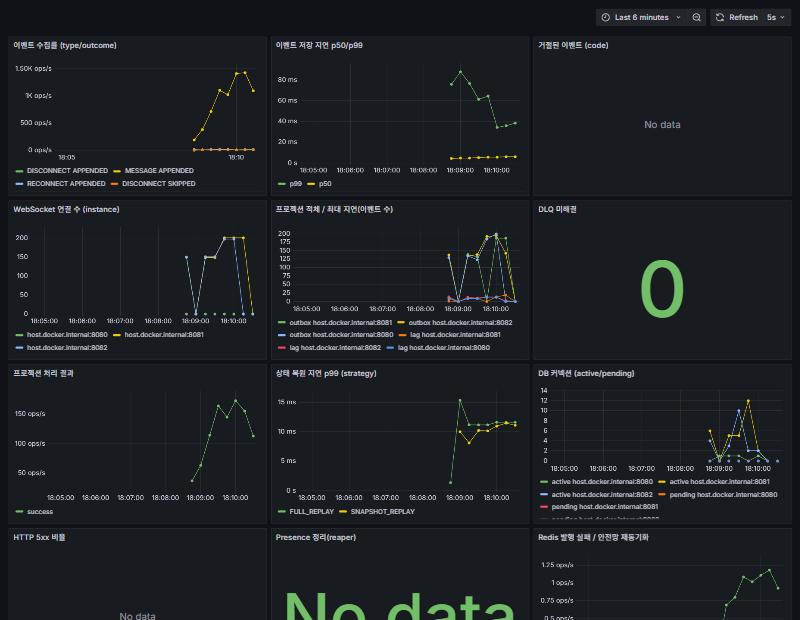

# 부하 테스트 · 성능 측정

## 1. 환경과 시나리오

| 항목 | 값 |
|---|---|
| 장비 | Windows 11 노트북 1대, Docker Desktop(WSL2, 16 vCPU, 7.4GB) |
| 구성 | `docker compose --profile cluster`: app-1, app-2(Spring Boot, 각 Hikari 30) + Nginx LB + Redis + PostgreSQL 17. **부하 생성기(k6)도 같은 장비에서 실행** |
| 스크립트 | [`loadtest/k6-chat.js`](../loadtest/k6-chat.js) |
| 시나리오 | 세션 N개, 세션마다 사용자 2명이 LB 를 거쳐 WebSocket 연결(인스턴스는 라운드 로빈으로 섞임). 각자 200ms 간격으로 메시지 30개 전송. 동시에 5 VU 가 `timeline` 복원 API 를 계속 호출 |
| 지표 | `ack_latency`(전송 → ack), `delivery_latency`(전송 → **상대방** 수신, 인스턴스 간 전달 포함), 전달 건수, timeline 응답 시간 |

```bash
docker run --rm -i --add-host=host.docker.internal:host-gateway -e BASE=http://host.docker.internal:8088 \
  -e SESSIONS=250 -e MESSAGES=30 -v "$PWD/loadtest:/scripts" grafana/k6 run /scripts/k6-chat.js
```

## 2. 결과 (최종)

| 동시 세션 (WS 연결) | 메시지 처리량 | ack p50 / p95 | 전달 p50 / p95 | 전달 완료 | timeline p95 | 오류 |
|---|---|---|---|---|---|---|
| 100 (200) | 131 msg/s | 8 / 15 ms | 9 / 15 ms | 6,000 / 6,000 | 7.2 ms | 0 |
| **250 (500)** | **322 msg/s** | **15 / 97 ms** | **16 / 101 ms** | **15,000 / 15,000** | 7.1 ms | 0 |
| 500 (1,000) | 623 msg/s | 1.5 s / 4.7 s | 1.5 s / 4.7 s | 27,204 / 30,000* | 6.4 ms | 0 |

\* 500 세션은 포화 구간이다. 지연이 4초를 넘으면서, 수신 측 VU 가 자기 전송을 마치고 3초 뒤 연결을 닫을 때 아직 도착하지 않은 메시지가 집계에서 빠졌다. 서버 측 유실은 아니다(모든 메시지가 APPENDED 되었고, 연결을 유지한 상태로 확인한 `many.mjs` 검증에서 6,000/6,000 수신). 원본 결과는 [`loadtest/results/`](../loadtest/results/) 에 있다.

**해석**
- 목표(ack p95 < 200ms, 전달 p95 < 300ms, 오류율 < 1%)를 **250 세션(WS 500, 322 msg/s)까지 만족**한다. 메시지 유실과 순서 어긋남은 0이다.
- 500 세션부터 포화된다. 앱 2대, DB, Redis, k6 가 **같은 노트북을 나눠 쓰는 환경**이라 절대 수치보다는 아래의 병목 추적과 개선 효과에 의미가 있다.
- 복원 API 는 부하 중에도 p95 7ms 전후로 안정적이다(스냅샷 덕분에 리플레이 구간이 짧음).

## 3. 병목 추적 과정

처음 결과는 좋지 않았다. 스레드 덤프와 메트릭으로 원인을 하나씩 찾아 고쳤다. **같은 시나리오(250 세션)의 변화**(1~2단계는 LB 편중 문제가 섞여 있던 측정이라 3단계 이후와 직접 비교하기 어렵다. 3단계에서 부하가 고르게 나뉘자 진짜 병목인 DB 커넥션 대기가 드러났다):

| 단계 | 증상 | 원인(근거) | 조치 | ack p95 | 전달 p95 |
|---|---|---|---|---|---|
| 0 | 일부 연결이 어느 순간부터 이벤트를 못 받음(수신 85%) | 처음에는 가상 스레드(JDK 21) 위에서 블로킹 전송 + 락 대기를 의심 | 연결별 **메일박스 + 플랫폼 스레드 전달 풀**로 구조 변경(락을 기다리며 잠드는 스레드 제거). **손실은 그대로였고 실제 원인은 1~2단계에서 밝혀짐** | — | — |
| 1 | 서버 재시작 직후 일부 연결이 뒷부분을 못 받음 | 세션 채널 **동적 구독**이 확정되기 전에 발행된 메시지 유실 → 다음 이벤트가 없으면 빈틈을 메울 계기가 없음 | **전달 안전망**(2초마다 로컬 연결 head 일괄 조회 후 따라잡기) | 5.4 s | 6.2 s |
| 2 | 같은 인스턴스 내 전달도 p50 0.7초 | Redis 채널별 구독자가 비정상(한 채널에 5명), 동시 구독 요청이 겹치면 구독이 꼬임(`PUBSUB NUMSUB` 로 확인) | 기동 시 **패턴 구독 1회**(`chat:session:*`) | 452 ms | 3.0 s |
| 3 | 부하가 app-1 에만 몰림(app-1 CPU 141%, app-2 5%) | 컨테이너 재생성으로 IP 가 바뀌었는데 Nginx 가 옛 주소를 캐시 | Nginx `resolver` + `server ... resolve`, 스케줄러 스레드 1→4 | 617 ms | 2.5 s |
| 4 | Tomcat 스레드 204개가 `HikariPool.getConnection` 에서 대기, **PG CPU 5%** | DB 연산이 아니라 **커넥션 점유 시간(왕복 + 커밋)** 이 병목 | 쓰기 핫패스 **writable CTE 로 왕복 3→1**, 메시지마다 하던 참여자 `last_seen` UPDATE 제거 | 139 ms | 1.86 s |
| 5 | 전달 스레드도 커넥션 대기 | 인스턴스 간 publish 순서가 뒤바뀌면 매번 DB 로 빈틈을 메움 → 풀 경합 악순환. Redis 리스너가 메시지마다 스레드 생성 | **재정렬 버퍼**(100ms 안에 채워지면 DB 미조회), 리스너 고정 풀, Hikari 20→30 | **97 ms** | **101 ms** |

교훈:
- **Pub/Sub 은 신뢰하지 않는다는 전제**(DB 가 진실, seq 로 빈틈 감지)가 실제로 버그를 덮어 주었다. 구독 버그가 있는 동안에도 메시지는 유실되지 않았고 느려지기만 했다. 그래서 "느려짐" 을 알 수 있도록 `chat_delivery_resync_total` 메트릭을 추가했다.
- 커넥션 풀 고갈은 DB CPU 가 아니라 **왕복 횟수 × 지연**의 문제였다. 풀을 키우기 전에 트랜잭션당 왕복을 줄이는 것이 먼저다.

## 4. 운영 대시보드

`docker compose --profile observability up -d` 를 실행하면 Grafana(http://localhost:3300, 익명 접속)에 대시보드가 자동 등록된다. 아래는 200 세션 부하 중 캡처다.



패널은 다음과 같다.
- 이벤트 수집률(type/outcome), 저장 지연 p50/p99, 거절 사유
- 인스턴스별 WebSocket 연결 수
- 프로젝션 적체와 최대 지연, DLQ, 처리 결과(success/retry/dlq)
- 복원 지연(strategy 별), DB 커넥션 active/pending, 5xx 비율
- reaper 정리 건수, Redis 발행 실패와 안전망 재동기화

## 5. 다음 단계
- 부하 생성기를 별도 장비로 분리하고 앱 인스턴스를 3대 이상으로 늘려 선형 확장성을 측정한다.
- 장시간(soak) 테스트로 이벤트 테이블 증가에 따른 지연 변화와 오토베큠 영향을 확인한다.
- 장애 주입 + 부하를 함께 실행한다(부하 중 `docker kill app-2` → 재연결 폭주 시 지연과 유실 0 확인).
